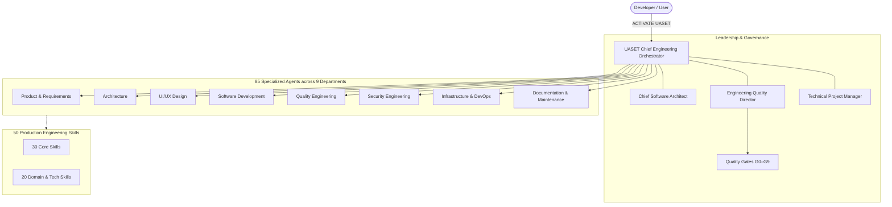

# Universal Antigravity Software Engineering Toolkit (UASET)

[](./package.json)
[](https://antigravity.google)
[](./quality-gates/QUALITY_GATES.md)
[-success.svg)](./evaluations/reports/FINAL_ENGINEERING_AUDIT.md)
[](./LICENSE)

**UASET** transforms Google Antigravity into an autonomous, professional, multi-agent AI software engineering organization. Supporting the complete software development lifecycle from discovery through production deployment and long-term maintenance, UASET provides dynamic specialist selection, progressive skill disclosure, strict Quality Gates (G0–G9), and universal cross-project independence.

---

## Architecture Overview



---

## Key Features

- **85 Specialized AI Agents:** Across 9 departments (Leadership, Product, Architecture, Design, Development, Quality, Security, Infrastructure, Documentation).
- **50 Production Engineering Skills:** Covering web, SaaS, mobile, desktop, backend, distributed systems, embedded firmware, AI/ML, security, and quality assurance.
- **Dynamic Specialist Selection:** Automatically analyzes workspace fingerprints to assemble the precise engineering team required.
- **Rigorous Quality Gates (G0–G9):** Automated, evidence-backed gates preventing fabricated test claims, unindexed queries, secret leaks, and unverified releases.
- **Universal Reusability:** Installed globally at `~/.gemini/config/plugins/uaset/`, instantly accessible across all Antigravity projects without code duplication.
- **14-Candidate Integration Register:** Curating patterns from Spec-Kit, BMAD, Superpowers, Supabase, Vercel, Trail of Bits, and Google Skills.
- **Benchmarked & Verified:** 6 diverse real-world benchmarks (SaaS, Mobile, Desktop, AI, Distributed, Embedded) tested with 100% pass rates.

---

## Quick Start

### 1. Global Activation Command
In any Antigravity conversation or workspace, simply type:

```text
ACTIVATE UASET
```

UASET will inspect the repository, assemble the departmental team, load the required skills, and initiate the engineering roadmap.

### 2. Standard Commands

| Command | Action |
| :--- | :--- |
| `ACTIVATE UASET` | Full organizational activation & execution planning |
| `UASET INIT` | Initialize `.uaset/config.json` in current workspace |
| `UASET STATUS` | Report active team, detected stack, and Quality Gates status |
| `UASET PLAN` | Trigger specification (PRD) and architecture (ADR) planning |
| `UASET BUILD` | Trigger implementation with assigned specialized engineers |
| `UASET REVIEW` | Run independent code review and constitutional audit |
| `UASET TEST` | Run automated unit, integration, and E2E test suites |
| `UASET SECURITY` | Perform SAST, secret detection, and vulnerability audit |
| `UASET PERFORMANCE` | Profile latency, database queries, and resource footprints |
| `UASET DEPLOY` | Prepare container manifests, IaC, and rollback plans |
| `UASET DOCUMENT` | Generate/update technical documentation and API specs |
| `UASET AUDIT` | Run end-to-end Quality Gates (G0–G9) evaluation |

---

## Directory Layout

```text
UASET/
├── agents/                     # 85 Specialized Agent Personas (.md)
├── skills/                     # 50 Modular Engineering Skills (SKILL.md)
├── departments/                # 9 Organizational Engineering Departments
├── domains/                    # Domain-specific Architectural Guides
├── quality-gates/              # Gates G0 through G9 Specification & Runner
├── templates/                  # Requirements, Architecture, SQL, API Templates
├── integrations/               # Third-Party Integration Register & Provenance
├── evaluations/
│   ├── benchmarks/             # 6 Real Executable Benchmark Projects
│   └── reports/                # Validation, Benchmark, & Final Audit Reports
├── bin/                        # UASET CLI Engine (uaset.js, uaset.cmd, uaset.ps1)
├── scripts/                    # Installer, Updater, Validator, & Generator Scripts
├── docs/                       # Architecture, Usage, Troubleshooting, & Catalogs
├── CONSTITUTION.md             # 20 Foundational Engineering Principles
├── AGENTS.md                   # Workspace & Inherited Engineering Directive
├── GEMINI.md                   # Platform Hook & Integration Guide
└── package.json                # Core Manifest & Runnable NPM Scripts
```

---

## Verification & Audit Evidence

- **System Diagnostics:** `npm run validate` $\rightarrow$ `100% HEALTHY` ([Report](./evaluations/reports/VALIDATION_REPORT.md))
- **Benchmark Execution:** `node scripts/validate/run-benchmarks.js` $\rightarrow$ `6/6 PASSED` ([Report](./evaluations/reports/BENCHMARK_REPORT.md))
- **Multi-Workspace Independence:** `node tests/test-project-independence.js` $\rightarrow$ `VERIFIED` ([Report](./evaluations/reports/INDEPENDENCE_REPORT.md))
- **Principal Engineer Audit:** `npm run audit` $\rightarrow$ `20/20 CRITERIA MET` ([Report](./evaluations/reports/FINAL_ENGINEERING_AUDIT.md))

---

## License

Apache-2.0. Copyright (c) 2026 UASET Engineering Leadership.
