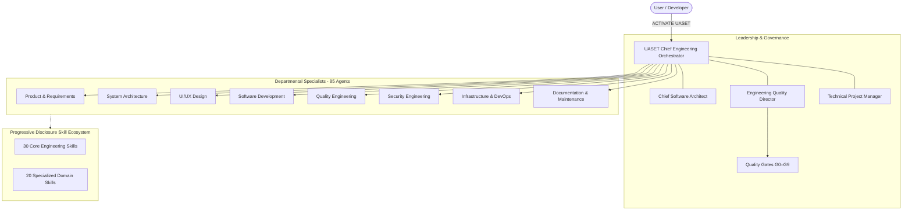

# UASET System Architecture & Technical Specifications

**Universal Antigravity Software Engineering Toolkit**  
*Document Version: 1.0.0 — Canonical Edition*  
*Standard: Multi-Agent Organization & Progressive Disclosure*

---

## 1. Architectural Topology

UASET transforms Google Antigravity into a hierarchical, autonomous software engineering organization using a modular multi-agent architecture:

---

## 2. Global vs. Workspace Boundary

UASET uses a clean two-tier discovery model to support universal reusability across multiple projects without code duplication:

1. **Global Plugin (`~/.gemini/config/plugins/uaset/`)**:
   - Holds the master skill definitions (`skills/`), agent markdown personas (`agents/`), global activation rules (`rules/AGENTS.md`), and `plugin.json`.
   - Discovered automatically by Antigravity across all projects on the host machine.
   - Zero duplication across repositories.

2. **Workspace Project (`<project-root>/`)**:
   - Holds project-specific configuration in `.uaset/config.json`.
   - Holds project source code, tests, and documentation.
   - Enforces Quality Gates G0–G9 locally without modifying global framework files.

---

## 3. Dynamic Specialist Selection Engine

When `ACTIVATE UASET` runs, the orchestrator inspects the workspace root for canonical fingerprint files:
- **Next.js / Prisma / TypeScript** $\rightarrow$ Activates Full-Stack SaaS Team (Frontend Engineer, Backend Engineer, Database Engineer, AppSec Engineer).
- **pubspec.yaml / app.json / Gradle** $\rightarrow$ Activates Mobile Engineering Team (Mobile Engineer, Android/iOS Engineer, UI/UX Designer).
- **tauri.conf.json / .csproj / electron** $\rightarrow$ Activates Desktop Engineering Team (Desktop Engineer, Windows Engineer, Systems Programmer).
- **langchain / requirements.txt / embeddings** $\rightarrow$ Activates AI/ML Engineering Team (AI/ML Engineer, Data Engineer, Security Architect).
- **docker-compose.yml / go.mod / Cargo.toml** $\rightarrow$ Activates Distributed Systems Team (Backend Architect, Distributed Systems Architect, DevOps Engineer).
- **platformio.ini / FreeRTOS / Zephyr** $\rightarrow$ Activates Embedded Systems Team (Embedded Engineer, Firmware Engineer, Systems Programmer).

---

## 4. The 8-Phase Engineering Lifecycle

1. **Discovery:** Project brief, problem statement, stakeholder analysis (Gate G0).
2. **Specification:** PRD, user stories, acceptance criteria, NFRs (Gate G0).
3. **Architecture:** Component boundaries, data models, API contracts, ADRs (Gates G1, G3).
4. **Design:** User journeys, design system tokens, WCAG 2.1 AA accessibility (Gate G2).
5. **Implementation:** Surgical, idiomatic code generation with zero dead code (Gate G4).
6. **Verification:** Real automated test suite execution (Unit, Integration, E2E) with 100% pass rate (Gate G5).
7. **Production Readiness:** Threat modeling, SAST scan, containerization, rollback runbook (Gates G6, G7, G8).
8. **Maintenance & Release:** SemVer bump, changelog update, user confirmation (Gate G9).
