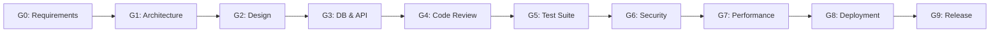

# UASET Quality Gates Specification (G0 – G9)

**Universal Antigravity Software Engineering Toolkit**  
*Document Version: 1.0.0 — Canonical Specification*  
*Enforcement: Automated & Orchestrator Controlled*

---

## Overview

Quality Gates ensure that software engineered with UASET meets rigorous technical, architectural, security, and operational standards before proceeding across lifecycle stages. Each gate defines explicit entry criteria, verifiable evidence, pass/fail rules, and remediation steps.

---

## Gate Specifications

### G0 — Requirements Approval
* **Lifecycle Phase:** Discovery & Specification
* **Responsible Roles:** Product Manager, Requirements Engineer, Technical Project Manager
* **Entry Criteria:** Initial stakeholder ideas, raw user stories, or feature requests submitted.
* **Required Evidence:**
  1. Product Requirements Document (PRD) or Specification Document.
  2. Distinct separation of Functional Requirements (FR) and Non-Functional Requirements (NFR).
  3. Acceptance Criteria defined in testable format (e.g., Given/When/Then or unambiguous bullet points).
  4. Explicit list of assumptions, constraints, and dependencies.
* **Pass Criteria:**
  - Zero ambiguous, contradictory, or unverifiable requirements.
  - Scope boundaries clearly demarcated.
  - Sign-off from Product Manager and Chief Software Architect.
* **Failure Criteria:** Vague requirements (e.g., "fast response time" without numeric SLA), unresolved dependencies, or missing business rationale.
* **Remediation:** Return to Requirements Engineer for refinement; prompt user for missing parameters.

---

### G1 — Architecture Approval
* **Lifecycle Phase:** System Architecture & Planning
* **Responsible Roles:** Solution Architect, Software Architect, Chief Software Architect
* **Entry Criteria:** Approved G0 Requirements.
* **Required Evidence:**
  1. System Architecture Document with component diagrams and data flow.
  2. Architecture Decision Records (ADRs) for major framework, pattern, and infrastructure choices.
  3. Boundary definitions (microservices, modules, layers).
  4. Scalability and disaster recovery plan.
* **Pass Criteria:**
  - Selected architecture directly satisfies all G0 NFRs.
  - KISS principle applied: no unwarranted distributed complexity or speculative layers.
  - Clear separation of concerns and domain boundaries established.
* **Failure Criteria:** Over-engineered architecture for simple problem domain, unaddressed single points of failure, missing ADRs.
* **Remediation:** Solution Architect refactors design and presents alternative simpler options.

---

### G2 — Design & UX Approval
* **Lifecycle Phase:** Design & Prototyping
* **Responsible Roles:** UI/UX Designer, Design Systems Engineer, Accessibility Specialist
* **Entry Criteria:** Approved G0 Requirements and G1 Architecture (for UI-bearing applications; skipped for headless backends/firmware).
* **Required Evidence:**
  1. User journey flows and wireframes.
  2. Design system tokens (color palette, typography scale, spacing units).
  3. Responsive layout specifications (mobile, tablet, desktop).
  4. Accessibility compliance checklist (WCAG 2.1 AA targets).
* **Pass Criteria:**
  - Adheres strictly to Anti-AI Slop guidelines (no generic purple gradients, card-in-card syndrome, or uniform square grids).
  - Clear visual hierarchy, consistent micro-interactions, and accessible contrast ratios (minimum 4.5:1 for normal text).
* **Failure Criteria:** Inaccessible color contrast, missing mobile viewport considerations, non-standard navigation patterns.
* **Remediation:** Design Systems Engineer updates color tokens and layout grids.

---

### G3 — Database & API Contract Approval
* **Lifecycle Phase:** Data Modeling & Interface Design
* **Responsible Roles:** Database Architect, API Architect, Security Architect
* **Entry Criteria:** Approved G1 Architecture and G2 Design (if UI exists).
* **Required Evidence:**
  1. Complete relational schema / NoSQL document schemas with foreign keys, constraints, and index strategy.
  2. Migration scripts (up and down/rollback) with zero data loss risk.
  3. Formal API specification (OpenAPI 3.1, GraphQL Schema, or Proto3 definitions).
  4. Authentication/authorization schema (RBAC/ABAC) on every endpoint.
* **Pass Criteria:**
  - Explicit data types, non-nullable fields with defaults, validated unique constraints.
  - RESTful / RPC conventions followed with standard HTTP status codes and structured error payloads.
  - Rate limiting, pagination, and query complexity bounds defined.
* **Failure Criteria:** Unindexed queries on large collections, missing rollback migration, unauthenticated data-mutating endpoints.
* **Remediation:** Database & API Architects adjust schemas and add migration tests.

---

### G4 — Implementation Review
* **Lifecycle Phase:** Software Development
* **Responsible Roles:** Principal Software Engineer, Independent Code Reviewer
* **Entry Criteria:** Implemented source code for approved tasks.
* **Required Evidence:**
  1. Clean source code adhering to language idioms and repository conventions.
  2. Linting and static analysis logs with zero errors.
  3. Independent code review comments addressed.
* **Pass Criteria:**
  - No dead code, orphan imports, or temporary debugging statements (`console.log`, `print`).
  - Strict typing enforced (no untyped `any` in TypeScript or unwrap without error handling in Rust).
  - No secret credentials or sensitive tokens in codebase.
* **Failure Criteria:** Linter errors, unresolved code review objections, architectural boundary violations (e.g. database query inside UI component).
* **Remediation:** Implementing developer refactors code to satisfy review comments.

---

### G5 — Automated Test Verification
* **Lifecycle Phase:** Quality Engineering
* **Responsible Roles:** QA Architect, Unit/Integration/E2E Test Engineers
* **Entry Criteria:** Approved G4 Implementation Review.
* **Required Evidence:**
  1. Automated test execution logs with verifiable exit code 0.
  2. Unit test coverage report (minimum 80% line coverage for critical business logic).
  3. Integration test results verifying API endpoints and database operations.
  4. E2E test results for critical happy path and edge case user journeys.
* **Pass Criteria:**
  - 100% test pass rate (zero failing tests, zero skipped critical tests).
  - Zero mock leakages into production bundles.
  - Reproducible locally and in CI environment.
* **Failure Criteria:** Any test failure, flaky tests, fabricated test outputs without command execution logs.
* **Remediation:** Test Engineer isolates failures, developer fixes bugs, complete test suite re-run.

---

### G6 — Security Verification
* **Lifecycle Phase:** Security Engineering
* **Responsible Roles:** Security Architect, Application Security Engineer, Threat Modeling Specialist
* **Entry Criteria:** Passing G5 Automated Tests.
* **Required Evidence:**
  1. Static Application Security Testing (SAST) scan report.
  2. Software Bill of Materials (SBOM) and dependency vulnerability scan (`npm audit`, `cargo audit`, `pip-audit`).
  3. OWASP Top 10 checklist verification (SQLi, XSS, CSRF, SSRF, IDOR, Broken Auth).
  4. Secret detection scan (zero hardcoded secrets or API tokens).
* **Pass Criteria:**
  - Zero Critical and High severity vulnerabilities.
  - Medium vulnerabilities documented with accepted risk and mitigation timeline.
  - Sanitized inputs and parameterized queries verified across all inputs.
* **Failure Criteria:** Any unmitigated High or Critical CVE, exposed secret keys, insecure default configurations.
* **Remediation:** Upgrade or patch vulnerable libraries, remediate insecure code paths.

---

### G7 — Performance & Reliability Verification
* **Lifecycle Phase:** Systems & Reliability Engineering
* **Responsible Roles:** Performance Engineer, SRE Engineer
* **Entry Criteria:** Passing G6 Security Verification.
* **Required Evidence:**
  1. Benchmark execution results (latency, throughput, memory consumption, CPU utilization).
  2. Core Web Vitals audit (LCP < 2.5s, CLS < 0.1, INP < 200ms) for web frontends.
  3. Database query execution plan (EXPLAIN ANALYZE) verifying no table scans on critical paths.
  4. Stress / load testing under simulated peak load.
* **Pass Criteria:**
  - Performance budgets met under target workload.
  - No unbounded memory leaks or thread starvation detected.
  - Graceful degradation / circuit-breaking verified.
* **Failure Criteria:** Latency spikes exceeding SLA, unindexed slow queries, memory leaks under sustained load.
* **Remediation:** Optimize hot loops, add caching layers, index queries, profile memory allocations.

---

### G8 — Deployment Readiness
* **Lifecycle Phase:** DevOps & Infrastructure
* **Responsible Roles:** DevOps Engineer, Cloud Engineer, Release Manager
* **Entry Criteria:** Passing G7 Performance Verification.
* **Required Evidence:**
  1. Production configuration files validated with environment variable templates (`.env.example`).
  2. Infrastructure as Code (IaC) linted and validated (Terraform plan, Helm lint, Docker multi-stage build).
  3. Health check endpoints (`/healthz`, `/ready`) operational.
  4. Documented, automated rollback plan tested in staging.
* **Pass Criteria:**
  - Production container images build cleanly with minimal attack surface (distroless / alpine where applicable).
  - Secrets injected securely via secret managers / runtime environment, not baked into container layers.
  - Automated deployment pipeline definitions validated.
* **Failure Criteria:** Missing environment variable documentation, broken container build, non-reproducible deployment script.
* **Remediation:** Infrastructure engineer repairs configuration and re-tests in dry-run mode.

---

### G9 — Release Approval
* **Lifecycle Phase:** Operations & Delivery
* **Responsible Roles:** Engineering Quality Director, Chief Engineering Orchestrator
* **Entry Criteria:** Passing G0 through G8 gates.
* **Required Evidence:**
  1. Comprehensive Quality Gate Sign-Off Matrix with evidence links.
  2. Release notes and CHANGELOG entry adhering to Semantic Versioning.
  3. User and operational documentation updated.
  4. User confirmation for final production release.
* **Pass Criteria:**
  - All preceding gates (G0–G8) verified with documented evidence.
  - Zero unresolved blockers or critical bugs.
  - User authorization granted.
* **Failure Criteria:** Unchecked gates, unverified evidence, missing user confirmation.
* **Remediation:** Address missing items; halt release until all criteria are satisfied.
