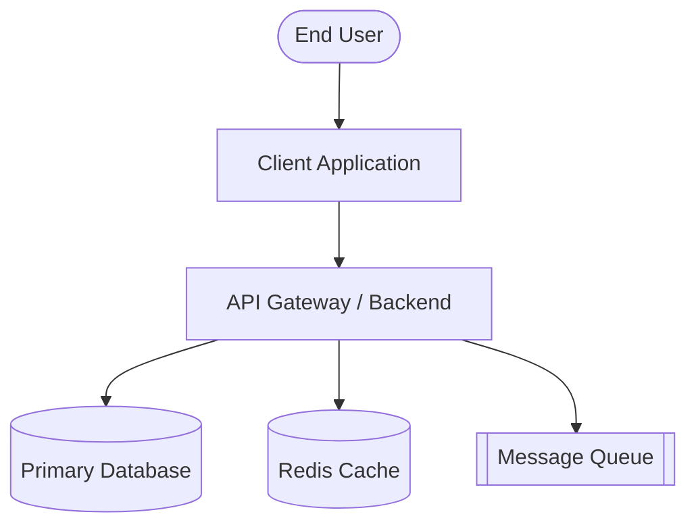

# [System Name] System Architecture Document

**Architecture Review:** Approved (Gate G1)  
**Author:** UASET Chief Software Architect & Solution Architect  
**Version:** 1.0.0

---

## 1. System Context & Overview (C4 Level 1)

## 2. Key Architectural Decisions (ADR Summary)
- Primary Language & Framework: ...
- Persistence Layer: ...
- Inter-service Communication: ...

## 3. Component Boundaries & Module Architecture (C4 Level 2)
*Detail each service, layer, and boundary.*

## 4. Scalability & Resilience Strategy
- Horizontal scaling, caching tiers, circuit breakers, and database connection pooling.

## 5. Security Architecture
- Trust boundaries, least privilege roles, token signing, and encryption in transit/at rest.
